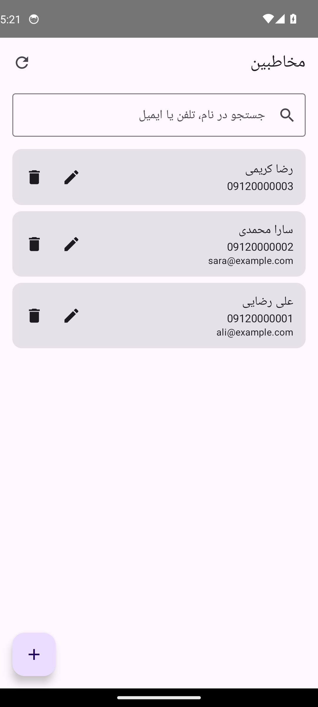
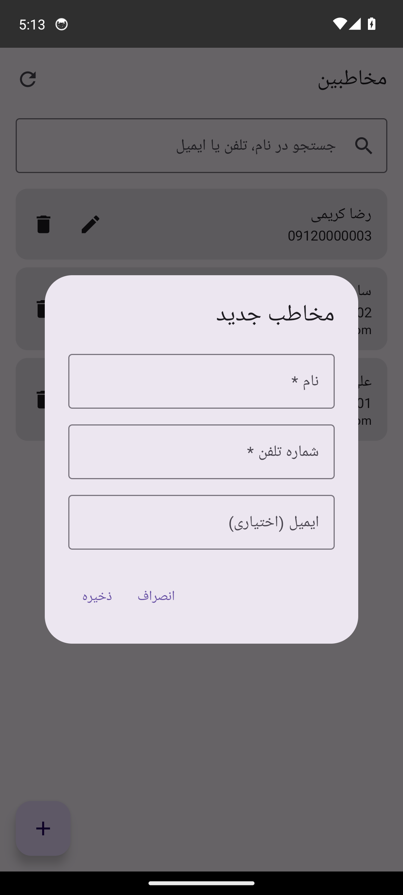
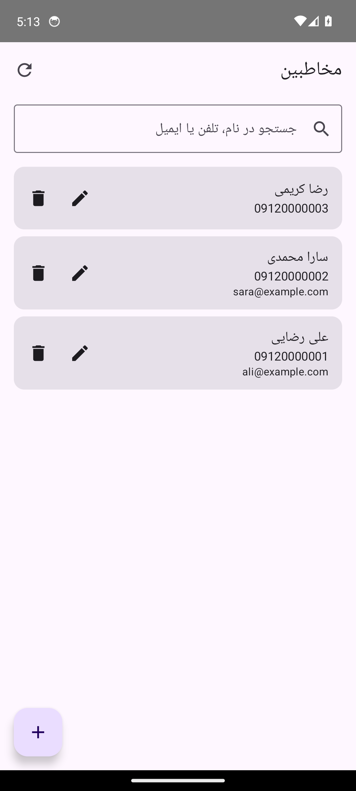

# اپ مخاطبین: آموزش دیتابیس آنلاین و آفلاین در اندروید

یک پروژه‌ی آموزشی کوچک برای یادگرفتن **معماری** کار با دیتابیس در اندروید:

- **دیتابیس آنلاین:** MySQL روی سرور، که با **PHP** به‌صورت API در دسترس است و اپ با **Retrofit2** به آن وصل می‌شود.
- **دیتابیس آفلاین:** **Room** داخل گوشی، که یک کپی از داده‌ها را نگه می‌دارد.
- **رابط کاربری:** Kotlin + Jetpack Compose (ساده؛ تمرکز روی معماری است).

امکانات: نمایش لیست مخاطبین (LazyColumn)، جستجو، افزودن، ویرایش و حذف (CRUD).

| لیست مخاطبین (از سرور) | افزودن مخاطب | حالت آفلاین (سرور خاموش، از Room) |
|---|---|---|
|  |  |  |

> این تصاویر خودکار در GitHub Actions گرفته می‌شوند: اپ روی شبیه‌ساز اندروید با سرور PHP/MySQL واقعی اجرا می‌شود (فایل `ci/screenshots.sh`).

---

## فهرست

1. ابزارهای لازم
2. ساختار پوشه‌ها
3. معماری پروژه
4. راه‌اندازی سرور (PHP + MySQL)
5. راه‌اندازی اپ اندروید
6. تست حالت آفلاین
7. خواندن کد، قدم به قدم
8. مشکلات رایج
9. تمرین برای ادامه‌ی یادگیری

---

## ۱. ابزارهای لازم

| ابزار | کاربرد |
|---|---|
| [Android Studio](https://developer.android.com/studio) (آخرین نسخه) | ساخت و اجرای اپ. JDK و Gradle را خودش دارد |
| [XAMPP](https://www.apachefriends.org/) | اجرای Apache (برای PHP) و MySQL روی کامپیوتر |

کتابخانه‌های اندروید (Room، Retrofit، Compose و ...) را لازم نیست دستی نصب کنید؛ Gradle موقع Sync خودش دانلود می‌کند.

---

## ۲. ساختار پوشه‌ها

```
CRUD/
├── README.md                ← همین فایل
├── php-api/                 ← سمت سرور
│   ├── database.sql         ← ساخت دیتابیس و جدول + چند رکورد نمونه
│   ├── config.php           ← اتصال به MySQL و توابع مشترک
│   ├── list.php             ← Read   (GET)
│   ├── create.php           ← Create (POST)
│   ├── update.php           ← Update (POST)
│   └── delete.php           ← Delete (POST)
└── android-app/             ← پروژه‌ی اندروید (این پوشه را در Android Studio باز کنید)
    └── app/src/main/java/com/example/contacts/
        ├── ContactsApp.kt           ← ساخت Room و Repository (یک بار در کل اپ)
        ├── MainActivity.kt          ← نقطه‌ی شروع اپ
        ├── data/
        │   ├── local/               ← Room (آفلاین)
        │   │   ├── ContactEntity.kt
        │   │   ├── ContactDao.kt
        │   │   └── AppDatabase.kt
        │   ├── remote/              ← Retrofit (آنلاین)
        │   │   ├── ContactDto.kt
        │   │   ├── ContactApi.kt
        │   │   └── ApiClient.kt
        │   └── ContactRepository.kt ← ترکیب آنلاین و آفلاین
        └── ui/
            ├── ContactViewModel.kt  ← وضعیت صفحه
            ├── ContactsScreen.kt    ← صفحه‌ی لیست + جستجو
            └── ContactDialog.kt     ← فرم افزودن/ویرایش
```

---

## ۳. معماری پروژه

این پروژه از معماری **MVVM + Repository** استفاده می‌کند. هر لایه فقط با لایه‌ی زیرینش حرف می‌زند:

```
┌────────────────────────────────────┐
│  UI  (ContactsScreen, ContactDialog) │   فقط نمایش می‌دهد و کلیک‌ها را به ViewModel می‌دهد
└─────────────────┬──────────────────┘
                  ▼
┌────────────────────────────────────┐
│  ContactViewModel                  │   وضعیت صفحه (لیست، جستجو، لودینگ، پیام)
└─────────────────┬──────────────────┘
                  ▼
┌────────────────────────────────────┐
│  ContactRepository                 │   تصمیم می‌گیرد داده از کجا بیاید / کجا برود
└────────┬──────────────────┬────────┘
         ▼                  ▼
  ┌─────────────┐    ┌─────────────┐          ┌───────────────┐
  │ Room (DAO)  │    │ Retrofit    │ ──HTTP──►│ PHP  +  MySQL │
  │ آفلاین      │    │ آنلاین      │◄──JSON── │ (سرور)        │
  └─────────────┘    └─────────────┘          └───────────────┘
```

**چرا لایه‌بندی؟** چون هر بخش یک وظیفه دارد. مثلاً اگر فردا سرور را از PHP به Node.js عوض کنید، فقط لایه‌ی `remote` تغییر می‌کند و UI و ViewModel دست نمی‌خورند.

### قانون اصلی: «Room منبع حقیقت است»

| عملیات | چه اتفاقی می‌افتد | بدون اینترنت؟ |
|---|---|---|
| **نمایش لیست** | UI همیشه از Room می‌خواند | ✅ کار می‌کند |
| **جستجو** | کوئری `LIKE` روی Room | ✅ کار می‌کند |
| **به‌روزرسانی (Refresh)** | لیست از سرور گرفته می‌شود و در Room جایگزین می‌شود | ❌ پیام خطا؛ داده‌های قبلی می‌مانند |
| **افزودن / ویرایش / حذف** | اول روی سرور، اگر موفق بود در Room | ❌ پیام خطا |

### جریان داده با یک مثال: افزودن مخاطب

1. کاربر فرم را پر می‌کند و «ذخیره» را می‌زند ← `ContactDialog`
2. `ContactsScreen` تابع `viewModel.addContact(...)` را صدا می‌زند.
3. `ContactViewModel` لودینگ را روشن می‌کند و `repository.add(...)` را صدا می‌زند.
4. `ContactRepository` با `api.createContact(...)` درخواست POST به `create.php` می‌فرستد.
5. `create.php` رکورد را در MySQL ذخیره می‌کند و رکورد جدید را (با `id`) به‌صورت JSON برمی‌گرداند.
6. Repository همان رکورد را با `dao.insert(...)` در Room ذخیره می‌کند.
7. چون لیست صفحه یک `Flow` از Room است، **خودش** به‌روز می‌شود. لازم نیست کسی لیست را دستی رفرش کند.
8. ViewModel پیام «مخاطب اضافه شد» را می‌گذارد و صفحه آن را در Snackbar نشان می‌دهد.

---

## ۴. راه‌اندازی سرور (PHP + MySQL)

1. **XAMPP Control Panel** را باز کنید و **Apache** و **MySQL** را Start کنید.
2. پوشه‌ی `php-api` را در `C:\xampp\htdocs\` کپی کنید و اسمش را به **`contacts-api`** تغییر دهید:
   ```
   C:\xampp\htdocs\contacts-api\config.php
   C:\xampp\htdocs\contacts-api\list.php
   ...
   ```
3. ساخت دیتابیس: در مرورگر به `http://localhost/phpmyadmin` بروید، تب **Import** را باز کنید، فایل `database.sql` را انتخاب کنید و **Go** (یا Import) را بزنید.
4. تست: در مرورگر به `http://localhost/contacts-api/list.php` بروید. باید چیزی شبیه این ببینید:
   ```json
   {"success":true,"message":"لیست مخاطبین","data":[{"id":3,"name":"رضا کریمی", ...}]}
   ```

> اگر MySQL شما رمز دارد یا اسم دیتابیس فرق دارد، مقادیر بالای `config.php` را عوض کنید.

### APIها

همه‌ی جواب‌ها این شکل را دارند: `{"success": true/false, "message": "...", "data": ...}`

| فایل | متد | بدنه‌ی درخواست | جواب (`data`) |
|---|---|---|---|
| `list.php` | GET | — | لیست مخاطبین |
| `create.php` | POST | `{"name":"...","phone":"...","email":"..."}` | مخاطب ساخته‌شده (با id) |
| `update.php` | POST | `{"id":1,"name":"...","phone":"...","email":"..."}` | مخاطب ویرایش‌شده |
| `delete.php` | POST | `{"id":1}` | `null` |

کدهای خطا: `422` = نام یا تلفن خالی است، `404` = مخاطب پیدا نشد، `405` = متد اشتباه، `500` = خطای سرور.

---

## ۵. راه‌اندازی اپ اندروید

1. Android Studio را باز کنید ← **Open** ← پوشه‌ی **`android-app`** را انتخاب کنید (نه پوشه‌ی CRUD).
2. صبر کنید تا **Gradle Sync** تمام شود. بار اول چند دقیقه طول می‌کشد چون کتابخانه‌ها دانلود می‌شوند.
3. یک شبیه‌ساز بسازید: **Device Manager** ← **Create Device** ← یک گوشی (مثلاً Pixel) با یک نسخه‌ی اندروید.
4. دکمه‌ی **Run ▶** را بزنید.

### آدرس سرور

آدرس در فایل `data/remote/ApiClient.kt` است:

```kotlin
private const val BASE_URL = "http://10.0.2.2/contacts-api/"
```

- **شبیه‌ساز:** همین مقدار درست است. در شبیه‌ساز، `10.0.2.2` یعنی `localhost` کامپیوتر شما.
- **گوشی واقعی:** گوشی و کامپیوتر باید به یک وای‌فای وصل باشند. IP کامپیوتر را با دستور `ipconfig` در CMD پیدا کنید (IPv4 Address) و جایگزین کنید، مثلاً `http://192.168.1.5/contacts-api/`.

### ساخت APK بدون Android Studio (با GitHub Actions)

اگر Android Studio ندارید، گیت‌هاب می‌تواند APK را برایتان بسازد (فایل `.github/workflows/build-apk.yml`):

1. پروژه را در یک ریپوی گیت‌هاب push کنید. ساخت APK خودکار شروع می‌شود (تب **Actions**، حدود ۵ دقیقه).
2. APK را از بخش **Releases** ← نسخه‌ی **latest** ← فایل `ContactsApp.apk` دانلود کنید و روی گوشی نصب کنید.
   (اندروید ممکن است بپرسد «نصب از منابع ناشناس» مجاز باشد یا نه؛ اجازه دهید.)

**آدرس سرور برای گوشی واقعی:** APK پیش‌فرض با آدرس شبیه‌ساز (`10.0.2.2`) ساخته می‌شود که روی گوشی کار نمی‌کند.
- در تب **Actions** ← **Build APK** ← **Run workflow**، آدرس را وارد کنید، مثلاً `http://192.168.1.5/contacts-api/`.
- یا یک بار در **Settings ← Secrets and variables ← Actions ← Variables** متغیر `API_BASE_URL` را بسازید تا همه‌ی بیلدها از آن استفاده کنند.
- گوشی و کامپیوتر باید روی **یک وای‌فای** باشند، و فایروال ویندوز باید اجازه‌ی اتصال به Apache (پورت 80) را بدهد.

---

## ۶. تست حالت آفلاین

1. اپ را با سرور روشن اجرا کنید تا لیست از سرور بیاید و در Room ذخیره شود.
2. در XAMPP، **Apache** را Stop کنید (یا اینترنت شبیه‌ساز را قطع کنید).
3. اپ را ببندید و دوباره باز کنید:
   - پیام «اتصال به سرور برقرار نشد...» نمایش داده می‌شود.
   - **ولی لیست و جستجو کار می‌کنند**، چون از Room خوانده می‌شوند. ✅
   - افزودن، ویرایش یا حذف خطا می‌دهد، چون به سرور نیاز دارند. ❌
4. Apache را دوباره Start کنید و دکمه‌ی 🔄 بالای صفحه را بزنید.

---

## ۷. خواندن کد، قدم به قدم

پیشنهاد می‌شود فایل‌ها را **به همین ترتیب** بخوانید؛ از پایین‌ترین لایه به بالا. در خود کدها هم توضیحات فارسی گذاشته شده است.

### قدم ۱: سرور: `php-api/`

1. **`database.sql`**: جدول `contacts` با چهار فیلد `id`، `name`، `phone` و `email`.
2. **`config.php`**: اتصال به MySQL با **PDO** و تابع `respond()` که همه‌ی جواب‌ها را JSON می‌کند.
   همه‌ی کوئری‌ها با **Prepared Statement** (`?`) نوشته شده‌اند تا جلوی SQL Injection گرفته شود.
3. **`list.php`، `create.php`، `update.php`، `delete.php`**: هر فایل یک عملیات CRUD.

### قدم ۲: دیتابیس آفلاین: `data/local/`

4. **`ContactEntity.kt`**: هر شیء از این کلاس یک ردیف جدول Room است. `@Entity` و `@PrimaryKey` را ببینید.
5. **`ContactDao.kt`**: کوئری‌ها. نکته‌ی مهم: `getAll()` و `search()` یک **`Flow`** برمی‌گردانند، یعنی هر تغییر در جدول خودکار به صفحه می‌رسد.
6. **`AppDatabase.kt`**: معرفی دیتابیس به Room. کد واقعی‌اش را Room موقع بیلد می‌سازد.

### قدم ۳: ارتباط با سرور: `data/remote/`

7. **`ContactDto.kt`**: شکل JSON سرور، و توابع `toEntity()` و `toDto()` برای تبدیل بین مدل سرور و مدل Room.
8. **`ContactApi.kt`**: هر تابع = یک فایل PHP. با `@GET`، `@POST` و `@Body` آشنا شوید. توابع `suspend` هستند، یعنی در Coroutine اجرا می‌شوند و UI را قفل نمی‌کنند.
9. **`ApiClient.kt`**: ساخت Retrofit با آدرس سرور و تبدیل‌کننده‌ی JSON (Gson).

### قدم ۴: قلب معماری: `data/ContactRepository.kt`

10. اینجا مشخص می‌شود خواندن از Room است و نوشتن اول روی سرور و بعد روی Room.
    بقیه‌ی اپ نمی‌داند Room یا Retrofit وجود دارند.

### قدم ۵: ساختن وابستگی‌ها: `ContactsApp.kt`

11. Room و Repository فقط یک بار، در کلاس `Application`، ساخته می‌شوند.
    این همان کاری است که کتابخانه‌هایی مثل **Hilt** خودکار انجام می‌دهند؛ اینجا عمداً دستی است تا دیده شود.

### قدم ۶: ViewModel: `ui/ContactViewModel.kt`

12. با این موارد آشنا شوید:
    - **`StateFlow`**: وضعیتی که UI آن را تماشا می‌کند.
    - **`flatMapLatest`**: با هر تغییر متن جستجو، کوئری جدیدی روی Room اجرا می‌شود.
    - **`runAction`**: الگوی مشترک «لودینگ، اجرا، پیام موفقیت یا خطا».
    - **`Factory`**: چون ViewModel ورودی دارد، باید بگوییم چطور ساخته شود.

### قدم ۷: رابط کاربری: `ui/`

13. **`ContactsScreen.kt`**: `Scaffold`، کادر جستجو، `LazyColumn` و دیالوگ تأیید حذف.
    با `collectAsStateWithLifecycle()` وضعیت ViewModel را می‌خواند.
14. **`ContactDialog.kt`**: یک فرم برای هر دو کار افزودن و ویرایش، با اعتبارسنجی ساده.

---

## ۸. مشکلات رایج

| مشکل | علت و راه‌حل |
|---|---|
| «اتصال به سرور برقرار نشد» در حالی که XAMPP روشن است | آدرس `BASE_URL` را چک کنید. روی شبیه‌ساز باید `10.0.2.2` باشد، نه `localhost`. آدرس باید با `/` تمام شود. |
| خطای `CLEARTEXT communication not permitted` | اندروید به‌طور پیش‌فرض اجازه‌ی `http` نمی‌دهد. در `AndroidManifest.xml` گزینه‌ی `usesCleartextTraffic="true"` گذاشته شده؛ مطمئن شوید پاک نشده باشد. |
| «خطای سرور (کد 500)» | MySQL روشن نیست، یا `database.sql` ایمپورت نشده، یا اطلاعات `config.php` اشتباه است. `list.php` را در مرورگر باز کنید تا پیام دقیق را ببینید. |
| «خطای سرور (کد 404)» | پوشه در `htdocs` اسمش `contacts-api` نیست، یا مخاطب قبلاً حذف شده. |
| گوشی واقعی به سرور وصل نمی‌شود | گوشی و کامپیوتر روی یک وای‌فای باشند و IP درست باشد. شاید فایروال ویندوز پورت 80 را بسته باشد. |
| Gradle Sync خطای دانلود می‌دهد | اتصال اینترنت یا تنظیمات پروکسی/DNS را بررسی کنید. |

---

## ۹. تمرین برای ادامه‌ی یادگیری

وقتی کد را فهمیدید، این‌ها را خودتان امتحان کنید (به ترتیب سختی):

1. یک فیلد جدید (مثلاً `address`) اضافه کنید. باید در **همه‌ی لایه‌ها** تغییر بدهید: SQL، PHP، Entity، DTO، فرم. (یادتان باشد `version` دیتابیس Room را هم یکی زیاد کنید.)
2. جستجو را به‌جای Room، روی سرور انجام دهید (`list.php?search=...`) و فرقش را در حالت آفلاین ببینید.
3. **Pull-to-refresh** به لیست اضافه کنید.
4. **افزودن آفلاین:** رکورد را با یک فیلد `isSynced = false` در Room ذخیره کنید و وقتی اینترنت وصل شد، با **WorkManager** به سرور بفرستید.
5. ساختن دستی وابستگی‌ها در `ContactsApp` را با **Hilt** جایگزین کنید.
